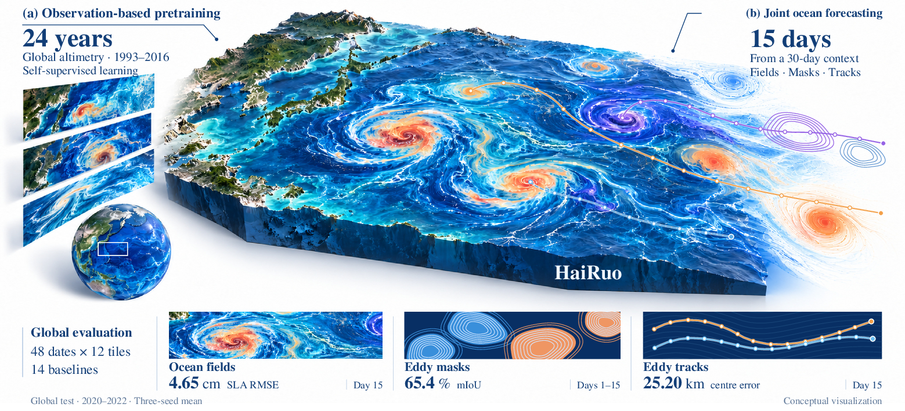
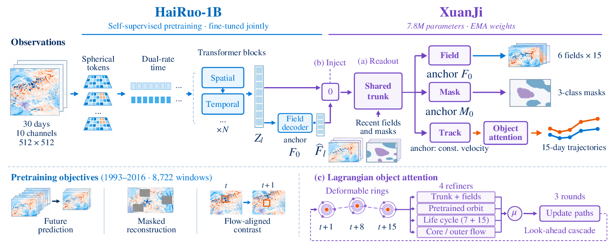
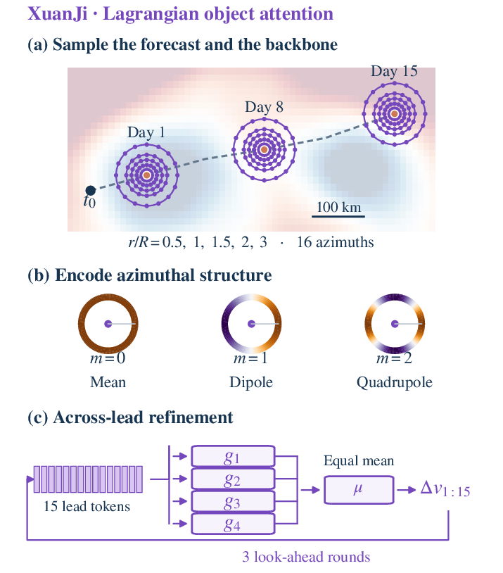
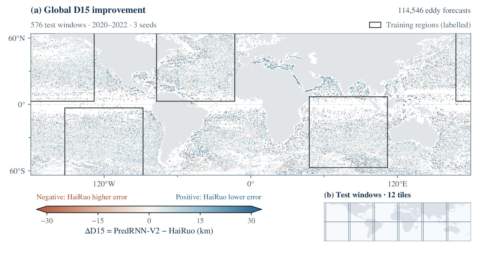
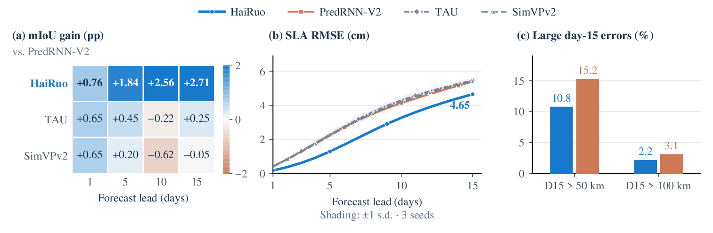
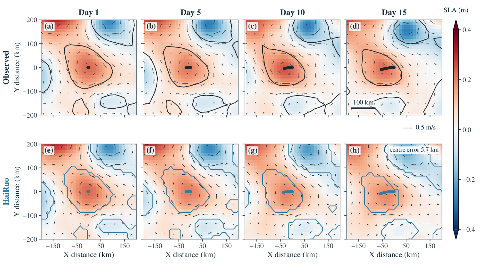

<div align="center">

# 🌊 HaiRuo

### Forecasting Ocean Eddies as Fields and Objects with a Satellite-Altimetry Foundation Model

**Xukun Qin**<sup>1,2</sup> &nbsp;·&nbsp; **Haochen Sun**<sup>1</sup> &nbsp;·&nbsp; **Yuyang Tian**<sup>2,3</sup> &nbsp;·&nbsp; **Ge Chen**<sup>1,*</sup>

<sup>1</sup>Ocean University of China &nbsp;·&nbsp; <sup>2</sup>Shanghai Artificial Intelligence Laboratory &nbsp;·&nbsp; <sup>3</sup>University of Science and Technology of China

[](configs/)




</div>

**HaiRuo** forecasts mesoscale eddies — the coherent 50–300 km vortices that carry most of the ocean's kinetic energy and transport heat, salt and carbon across basins — **as continuous physical fields and as discrete Lagrangian objects in a single forward pass**. From 30 days of satellite sea-level maps, HaiRuo returns 15 days of sea-level and geostrophic-velocity fields, daily cyclonic and anticyclonic eddy masks, and the 15-day trajectory of every eddy alive today.

HaiRuo pairs two components with a clear division of labour:

- **HaiRuo-1B**, a **1.05-billion-parameter** spatio-temporal ocean foundation model pretrained without labels on **24 years** of global satellite-altimetry **observations**, which supplies the 15-day physical fields and masks ($+0.14$ field skill and $+1.1$ mIoU points under the same decoder) and lowers 15-day centre error by $1.2\text{ km}$ frozen ($1.35\text{ km}$ over training the identical 1B model from scratch);
- **XuanJi**, a co-moving polar **Lagrangian object decoder** that samples the evolving forecast along each eddy's predicted orbit (mean intensity, self-advection dipole and strain quadrupole modes) and refines all 15 leads jointly across three look-ahead rounds and four refiners, removing **$2.5\text{ km}$** on HaiRuo-1B (**$2.9\text{ km}$** with joint fine-tuning) and **$2.5\text{--}3.3\text{ km}$** as a plug-in across six published video-prediction backbones.

---

## 📰 News

- **2026-11** — Model configurations, normalisation statistics and SHA-256 manifests are available in this repository. Open-weight checkpoints (`HaiRuo-1B`, `HaiRuo`, `XuanJi` and `HaiRuo-200M`) will be released soon.

## ✨ Highlights

- 🛰️ **An observation-pretrained ocean foundation backbone (`HaiRuo-1B`).** Pretrained without labels on every daily window of 1993–2016 global $1/8^\circ$ altimetry with a two-stage spherical $0.5^\circ$ stem, dual-rate 30-day memory, eddy-focused chirality-gated attention, multi-axis masked reconstruction and a geostrophic flow-advected contrast. Even with plain base heads (no object attention), frozen HaiRuo-1B (`25.76 km` D15, `67.10%` mIoU, `0.771` field skill on Dev48) beats all 14 baselines as well as 22-epoch self-supervised PredRNN-V2 pretrained on the same global altimetry archive (`30.36 km` frozen, `26.58 km` fine-tuned).
- 🎯 **The object belongs in the decoder (`XuanJi`).** Co-moving polar object attention alone removes **1.91 km** of 15-day centre error on frozen HaiRuo-1B (and **2.48 km** with full three-round four-expert look-ahead refinement), while plugging two-round XuanJi object attention into six published video-prediction backbones lowers D15 on every one of them by **2.49–3.34 km**.
- 🌍 **State-of-the-art across the global ocean and through ENSO.** On the pre-registered 2020–2022 global evaluation (48 dates $\times$ 12 tiles covering $64^\circ\text{S}$–$64^\circ\text{N}$, every model scored once), HaiRuo improves on **all 14 baselines on every endpoint**: **25.20 km** 15-day centre error (**$-18\%$** against the strongest baseline, PredRNN-V2 at `30.58 km`), **65.40%** mIoU, **0.736** field skill and **4.65 cm** day-15 sea-level RMSE — holding a **17–18%** margin outside the four labelled training regions and across both El Niño and La Niña phases.
- 🌊 **Emergent ocean physics.** Without hard-wired propagation constraints, HaiRuo reproduces latitudinal Rossby westward drift ($r = 0.980$ with observed atlas drift), the $50\text{--}60^\circ\text{S}$ Antarctic Circumpolar Current eastward reversal, poleward deflection of cyclones relative to anticyclones in both hemispheres, and geostrophic balance ($r = 0.901$ between $-\nabla\hat{\eta}$ and predicted geostrophic velocity).
- 🧭 **Beyond global AI ocean forecasters (`WenHai` & `XiHe`).** Over 10-day forecasts on Test48: (i) *field-for-field through the same fixed tracker*, HaiRuo's forecast field scores **29.5 km**, cutting WenHai (`47.1 km`) and XiHe (`51.6 km`) by **37–43%**, landing within `0.52 km` of true altimetry (`29.0 km`), and improving by **2.8 km** over its held-fixed day-0 state while WenHai and XiHe degrade by $+4.3$ and $+8.7\text{ km}$; (ii) *as direct object trajectories*, HaiRuo reaches **10.1 km** on Test48 and **11.2 km** globally (**77–78%** lower than pipeline tracking on WenHai and XiHe).

---

## 🏗️ Architecture

<div align="center">

</div>

**HaiRuo-1B (Foundation Backbone).** A two-stage spherical stem embeds each daily $1/8^\circ$ map into $0.5^\circ$ eddy-resolving tokens (so a typical mesoscale eddy spans 2–6 tokens across its core and rim), while two stride-2 convolutions construct $1^\circ$ and $2^\circ$ multi-scale hierarchies. The 30-day input history is compressed at two rates — the last 7 days remain explicit while the preceding 23 days are pooled into 8 learned memory slots — and processed by eddy-focused spatio-temporal blocks combining shifted-window attention, chirality-gated depthwise convolutions and cross-time attention. A multi-scale residual decoder queries each lead $l \in \{1,\dots,15\}$ and outputs all 15 daily field residuals in one forward pass: $\hat{F}_l = F_0 + \delta_l \odot r_l$.

**XuanJi (Lagrangian Object Decoder).** A multi-scale spatial trunk feeds persistence-anchored field, mask and initial trajectory heads. Around each eddy's predicted centre at lead $l$, XuanJi samples the evolving forecast and backbone features on five concentric rings $r/R \in \{0.5, 1, 1.5, 2, 3\}$ at 16 azimuths, projects each ring onto its $m = 0, 1, 2$ azimuthal Fourier modes (capturing core intensity, self-advection dipole and shearing quadrupole), attends across all 15 lead tokens, and refines the 15-day trajectory across three look-ahead rounds averaged over four diverse refiners.

<div align="center">

</div>

---

## 📊 Main Results

**Global evaluation (`2020–2022`)**: 48 test dates $\times$ 12 tiles covering all longitudes between $64^\circ\text{S}$ and $64^\circ\text{N}$ (192,316 eddies at $t_0$; 114,546 alive at day 15), three-seed means. *Training regions*: the four regions providing labelled training windows; *Other regions*: the remaining $\sim 74\%$ of the global ocean, never seen in labelled training.

| Method | D15 Global (km) ↓ | D15 Training Regions ↓ | D15 Other Regions ↓ | Mean Centre (km) ↓ | mIoU (%) ↑ | Field Skill ↑ | SLA RMSE Day 15 (cm) ↓ |
|---|---:|---:|---:|---:|---:|---:|---:|
| **HaiRuo (ours)** | **25.20** | **22.74** | **27.64** | **14.03** | **65.40** | **0.736** | **4.65** |
| PredRNN-V2 | 30.58 | 27.53 | 33.61 | 17.01 | 63.31 | 0.556 | 5.39 |
| PhyDNet | 30.59 | 27.54 | 33.63 | 16.89 | 63.50 | 0.549 | 5.40 |
| TAU | 30.64 | 27.73 | 33.52 | 16.70 | 63.50 | 0.578 | 5.46 |
| SimVPv2/gSTA | 30.85 | 27.91 | 33.77 | 16.81 | 63.21 | 0.588 | 5.42 |
| SimVP | 30.96 | 28.11 | 33.80 | 16.85 | 62.15 | 0.520 | 5.80 |
| U-Net | 31.00 | 28.09 | 33.88 | 16.94 | 59.93 | 0.309 | 7.56 |
| ConvLSTM | 31.19 | 28.24 | 34.13 | 17.07 | 63.28 | 0.553 | 5.49 |
| EddyNet | 32.88 | 30.27 | 35.47 | 17.73 | 61.98 | 0.438 | 6.04 |
| PredFormer | 33.20 | 30.56 | 35.82 | 17.97 | 60.57 | 0.411 | 6.06 |
| Earthformer | 33.41 | 30.38 | 36.43 | 18.05 | 61.16 | 0.459 | 5.75 |
| LSTM+Informer (tracks only) | 34.05 | 31.21 | 36.89 | 18.29 | — | — | — |
| SwinLSTM-B | 34.28 | 31.53 | 37.02 | 18.63 | 58.96 | 0.130 | 6.60 |
| FNO-2d | 34.90 | 32.14 | 37.65 | 19.01 | 53.83 | 0.251 | 6.48 |
| Track Transformer (tracks only) | 36.66 | 34.05 | 39.24 | 19.58 | — | — | — |

<details>
<summary><b>More results: Test48, ENSO regimes, global ocean forecasters, and component ablations</b></summary>

<br>

| Evaluation | HaiRuo | Comparison |
|---|---|---|
| Four-region test set (Test48), D15 / Centre / mIoU / Field | **22.41 km / 12.54 km / 67.71% / 0.768** | Ahead of all 14 baselines on every metric |
| Foreground EddyIoU / 1-px Boundary F1 (Test48) | **57.86% / 74.17%** | $+1.87\text{ pp}$ EddyIoU and $+1.78\text{ pp}$ BF1 over PredRNN-V2 |
| Unconditioned $>25\text{ km}$ miss rate / Short-lived eddies ($\le 7\text{ d}$) | **12.17% / 13.16 km** | $-26.4\%$ relative miss-rate reduction vs. PredRNN-V2 (`16.52%`) |
| El Niño windows, other regions, D15 | **28.24 km** | `34.12 km` for the strongest baseline ($-17.2\%$) |
| La Niña windows, other regions, D15 | **27.28 km** | `33.20 km` for the strongest baseline ($-17.8\%$) |
| WenHai / XiHe, forecast field through same fixed tracker (Test48) | **29.5 km** | **37–43%** below WenHai (`47.1 km`) and XiHe (`51.6 km`); within `0.52 km` of true altimetry (`29.0 km`) |
| WenHai / XiHe, direct object trajectories (global, leads 1–10) | **11.2 km** (`10.1 km` on Test48) | **77–78%** below WenHai (`48.0 km`) and XiHe (`52.0 km`) |
| Frozen HaiRuo-1B vs. decoder alone (Dev48) | Field skill $0.63 \to \mathbf{0.77}$, **$+1.09$** mIoU, **$-1.19\text{ km}$** D15 | Identical XuanJi decoder |
| HaiRuo vs. identical 1B model trained from scratch (Dev48) | **$-1.35\text{ km}$** D15, **$+1.12$** mIoU, **$+0.107$** field skill | Same architecture, same decoder, same labels |
| Frozen HaiRuo-1B vs. 22-epoch self-supervised PredRNN-V2 (Dev48) | **25.76 km** vs. `30.36 km` frozen (`26.58 km` fine-tuned) | Both under shared base heads without object attention |
| XuanJi object attention across 6 published backbones (Dev48) | **$-2.49\text{ to }-3.34\text{ km}$** D15 on every backbone | Masks and fields unchanged |

</details>

---

## 🌍 Visual Gallery

<div align="center">

<sub><b>Global 15-day trajectory improvement.</b> Per-eddy 15-day centre-error gain of HaiRuo over PredRNN-V2 across 114,546 eddy forecasts on 576 global test windows (2020–2022, three seeds).</sub>
<br><br>

<sub><b>Forecast skill and tail reliability across leads 1–15.</b> Segmentation gain by lead, sea-level RMSE by lead, and fraction of eddies exceeding 50 km and 100 km error at day 15.</sub>
<br><br>

<sub><b>15-day eddy forecast case.</b> HaiRuo preserves the closed vortex structure, azimuthal velocity gradient and centre trajectory across all 15 days.</sub>
</div>

---

## 🧠 Model Zoo & Configurations

Model configurations, training hyper-parameters and DUACS normalisation statistics are provided in [`configs/`](configs), and SHA-256 digests of the checkpoint shards are recorded in [`checkpoints/SHA256SUMS.txt`](checkpoints/SHA256SUMS.txt). Open-weight `.safetensors` checkpoints will be released soon.

| Model | Description | Parameters | Tokens | Precision | Config | Size | Status |
|---|---|---:|:---:|:---:|:---:|---:|:---:|
| **HaiRuo-1B** | Pretrained foundation backbone (self-supervised, 93 epochs on 1993–2016 global altimetry) | 1.05 B | $0.5^\circ$ | `fp32` | [`config`](configs/hairuo_1b_pretrained.config.json) | 4.2 GB | *Coming soon* |
| **HaiRuo** | Full system: HaiRuo-1B fine-tuned jointly with XuanJi | 1.05 B + 7.85 M | $0.5^\circ$ | `bf16` / `fp32` | [`config`](configs/xuanji_decoder_hairuo_s42.config.json) | 2.1 GB + 31 MB | *Coming soon* |
| **XuanJi (frozen 1B)** | XuanJi decoder trained on frozen pretrained HaiRuo-1B | 7.85 M | — | `fp32` | [`config`](configs/xuanji_decoder_frozen_hairuo_1b_s42.config.json) | 31 MB | *Coming soon* |
| **HaiRuo-200M** | Scaling-study pretrained backbone (22 epochs on 1993–2016 global altimetry) | 229 M | $1.0^\circ$ | `fp32` | [`config`](configs/hairuo_200m_pretrained.config.json) | 0.9 GB | *Coming soon* |

---

## 🗺️ Data & Pre-Registered Protocol

| Component | Specification |
|---|---|
| **Altimetry inputs** | Copernicus Marine DUACS delayed-time global L4 sea level (`SEALEVEL_GLO_PHY_L4_MY_008_047`, `vNov2024`), $1/8^\circ$ daily grids: $\text{SLA}$, $\sigma_{\text{SLA}}$ quality map, $\text{ADT}$, $(u_g, v_g)$ and $(u'_g, v'_g)$ |
| **Eddy labels** | AVISO+ `META4.0` all-satellite mesoscale eddy atlas (contours rasterised to $1/8^\circ$ and daily centre tracks) |
| **Self-supervised pretraining** | All 8,722 daily 45-day windows in 1993–2016; area-uniform ($\propto \cos\phi$) random $512 \times 512$ global ocean tiles |
| **Supervised readout** | Pre-registered 1,024-window subset (256 per region across North Atlantic, North Pacific, South Pacific and Indian Ocean) + full 8,722-window scaling evaluation |
| **Development split** | `Dev48` (48 dates in 2017–2019, 4 per quarter $\ge 7$ days apart) — used for all model selection and ablations |
| **Independent test splits** | `Test48` (48 dates in 2020–2022 on the four regions) and `Global` (48 dates $\times$ 12 tiles covering $64^\circ\text{S}$–$64^\circ\text{N}$), each scored once with fixed final checkpoints |

---

## 📁 Repository Layout

```text
├── checkpoints/   Checkpoint manifest and SHA-256 digests (SHA256SUMS.txt)
├── configs/       Model configurations and DUACS 1993–2016 normalisation statistics (configs/stats/)
├── docs/          Interactive project page (https://xkqin.github.io/HaiRuo/)
└── .github/       Figures and visual assets
```

---

## 📝 Citation

```bibtex
@article{qin2026hairuo,
  title   = {HaiRuo: Forecasting Ocean Eddies as Fields and Objects with a Satellite-Altimetry Foundation Model},
  author  = {Qin, Xukun and Sun, Haochen and Tian, Yuyang and Chen, Ge},
  journal = {arXiv preprint},
  year    = {2026}
}
```

---

## 🙏 Acknowledgements

We thank the Copernicus Marine Service (CMEMS) for distributing the DUACS global satellite-altimetry record and AVISO+ / CNES / CLS for the META4.0 mesoscale eddy atlas, as well as the authors of the baseline architectures and the released WenHai and XiHe ocean forecasting systems.
